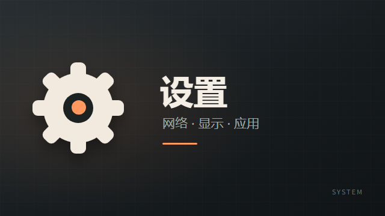
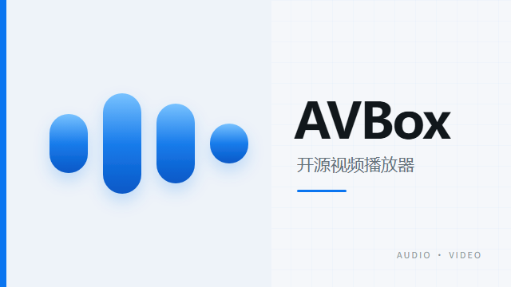
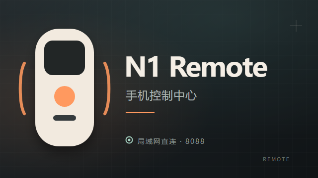

# CleanYourTV N1 Edition

这是 [Gathin23/cleanyourtv](https://github.com/Gathin23/cleanyourtv) 的非官方 N1 衍生版本，针对斐讯 N1（Android 7.1 / API 25）和客厅电视使用场景做了兼容与集成改进。

> 上游项目仍是非 N1 电视的首选版本。本项目不代表上游作者或官方发行。

## N1 版本特性

- 验证 N1 `p230`、`N1_A0_V2.19_A00_0307_NS`、Android 7.1.2 / API 25。
- 冷启动后 Dock 固定在底部，第一张卡稳定获得焦点。
- 修复开机应用扫描慢导致的高亮框错位和网格抢占焦点。
- 首页集成 N1 Remote 地址、动态 PIN 和自动登录二维码。
- 通过同签名 `signature` 权限读取 PIN，不开放匿名局域网状态接口。
- 提供 Remote、AVBox、设置、OrionTV 等 16:9 电视横幅，可持久覆盖应用更新。
- `app_banners` 按包名映射，应用重新安装后仍保持横幅。
- 增加 API 25 兼容的二维码依赖和二维码卡布局。
- 默认首页可由系统明确设置，避免卸载替代桌面后弹出选取框。

<table>
  <tr>
    <td align="center"><br><sub>设置</sub></td>
    <td align="center"><br><sub>AVBox</sub></td>
    <td align="center"><br><sub>N1 Remote</sub></td>
  </tr>
</table>

## 安装

```powershell
adb install -r dist\CleanYourTV-N1-API25.apk
adb shell cmd package set-home-activity com.gathin.tvhome/.MainActivity
```

建议同时安装配套的 `N1 Pocket Remote`。两个 APK 必须使用同一签名，首页状态 Provider 才会授权。

详细步骤见 [docs/n1/INSTALL.md](docs/n1/INSTALL.md)，构建说明见 [docs/n1/BUILD.md](docs/n1/BUILD.md)。

## 兼容性

- 当前测试电视 EDID 仅上报最高 `1080p60`，没有 4K UI 模式。
- N1 使用 Mali-450 MP3、约 1.8 GB 内存。
- 1080p60 连续焦点测试为 912 帧、0 卡顿帧，95% 帧耗时约 6 ms。
- Android 版本低于 API 25 或没有 Leanback 启动入口的设备不在兼容承诺内。

## 开源与归属

- 上游项目：<https://github.com/Gathin23/cleanyourtv>
- 上游许可证：MIT
- 本仓库保留上游来源提交、`LICENSE` 和版权声明。
- 修改内容与第三方资源说明见 [NOTICE.md](NOTICE.md)。

本衍生版同样按 MIT License 分发。

